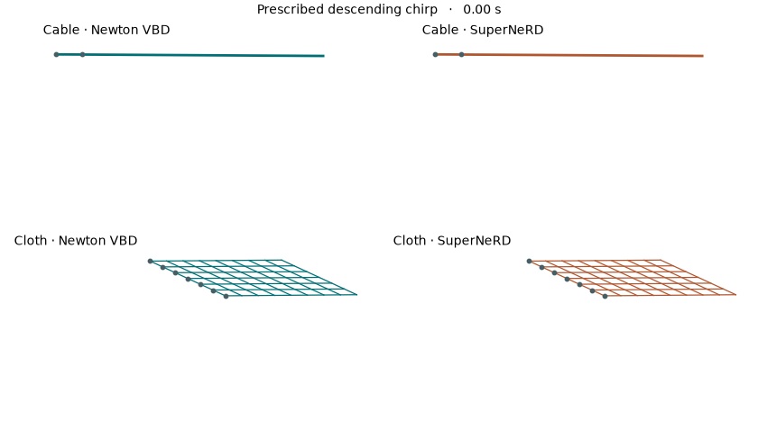

# SuperNeRD

SuperNeRD learns how a deformable object moves under a given force. One forward model shares its weights across cables and cloth. The primary experiment measures the Newton data required, time to fit, and shape and force-response errors over complete unseen trajectories.

[Read the paper](https://maxkra15.github.io/supernerd/) · [PDF](paper/deformable-physics.pdf) · [Watch Newton and SuperNeRD side by side](figures/newton-supernerd.gif)

On 16 fresh objects and 80 six-second trajectories, the shared model averages **1.57% of cable length and 4.28% of cloth length** in native-vertex position error. Its 8,000-update fit took **28.9 seconds on one GPU**. Generating the 768 training trajectories took another **168.9 seconds on eight CPU workers** across two timed exports with warm kernels. On the smaller motion caused by changing just the force, the mean relative error is **55.6% for cable and 89.8% for cloth**. These tests use fixed supports and free-space deformation. At batch one on a single CPU core, updating native-vertex positions was 112× faster than Newton for cable and 139× for cloth. [Matched timings](deformables/results/matched-forward-timing.json).

## Reproduce

- [Shared model, replay from stored weights, and teacher generation](deformables/MODAL_REPRODUCTION.md)
- [Streaming attention model and cache timing](deformables/STREAM.md)
- [Calibration from a few force programs on a single asset](deformables/asset/)
- [Training and held-out trajectories](deformables/data/), [checkpoints](deformables/weights/), [measurements](deformables/results/)
- [Original NeurALL experiments](https://maxkra15.github.io/neurall/) and [archived CartPole policy study](https://maxkra15.github.io/supernerd/cartpole.html)

To render the paper with a uv environment containing Jinja2, NumPy and Matplotlib, and a local Google Chrome installation for PDF export, run the following from the repository root.

~~~sh
uv run --no-project .venv/bin/python deformables/motion_figure.py
uv run --no-project .venv/bin/python scripts/build_deformables.py --pdf
~~~

SuperNeRD's original code is released under the [Apache License 2.0](LICENSE).
