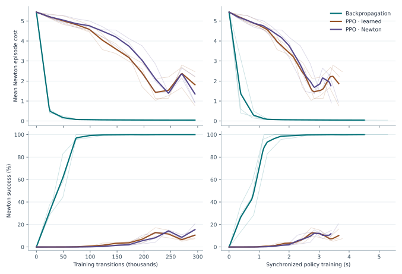

# SuperNeRD

**Differentiable robot dynamics for policy learning**

[Read the paper](https://maxkra15.github.io/supernerd/) · [Download the PDF](paper/supernerd.pdf) · [NeurALL deformable research](https://maxkra15.github.io/neurall/)

## Abstract

SuperNeRD fits a compact world model to Newton CartPole transitions and computes policy gradients through short imagined rollouts. Three training seeds reach 90% success in held-out Newton evaluation at the first measured checkpoint after 73,728 imagined transitions. Median policy-training time to this threshold is 5.90× lower than PPO on the same learned simulator. After counting dynamics commissioning and scheduled Newton evaluations, it is 2.39× lower. Longer PPO runs also reach 100% success and improve the control cost recorded at the initial gradient budget.

The learned forward graph is 8.77× faster than the local Newton graph at 2,048 worlds. Its passive 200-step prediction drift is substantial. A CartPole-specific mechanical prior improves that prediction by orders of magnitude. This is a controlled CartPole policy result. FlashNeRD's state-of-the-art contact and locomotion protocols require a separate matched replication.



## Reproduce

- [CartPole training, evaluation and dependencies](paper/cartpole-reproduction.md)
- [Original public NeRD checkpoint and legacy protocol](paper/official-nerd-reproduction.md)
- [Replication protocol and FlashNeRD benchmarks](paper/replication-protocol.md)
- [Raw policy and dynamics measurements](results/)
- [Learned dynamics and policy weights](weights/)

The CartPole asset is downloaded at the exact public NeRD revision through the reproduction recipe. NeRD and Newton are separate upstream Apache-2.0 projects.

With the pinned environment prepared, run from the repository root.

```sh
uv run --no-project .venv/bin/python benchmark.py \
  --urdf cartpole_single.urdf --output run --newton-ppo

uv run --no-project .venv/bin/python structured_dynamics.py \
  --urdf cartpole_single.urdf --traces run/shared-cartpole-traces.npz \
  --output run/structured.json --device cpu

uv run --no-project .venv/bin/python check_action_gradients.py \
  --urdf cartpole_single.urdf --model run/model.pt \
  --output run/action-gradients.json --device cpu
```

Build the paper and figures from the archived measurements.

```sh
uv run --no-project --with jinja2 scripts/build_paper.py
uv run --no-project --with matplotlib --with numpy scripts/plot_results.py
uv run --no-project python -m http.server 8765 --bind 127.0.0.1
```

Open the served root in a browser. The PDF uses the print stylesheet.

## License

SuperNeRD's original code is released under the [Apache License 2.0](LICENSE).
