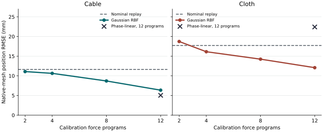

# How quickly can one cable or cloth be calibrated?

Twelve forced trajectories and one nominal recording gave a predictor for each individual object in about six seconds of CPU teacher generation. Fitting the Gaussian radial-basis-function (RBF) network then took 12 ms per cable and 22 ms per cloth. For 32 new force programs per material, it reduced full-trajectory position error from 11.63 to 6.35 mm on cable and from 17.72 to 12.08 mm on cloth. Cable had its lowest error with a simpler phase-varying linear filter, at 5.04 mm.

| Same 12 calibration programs per asset | Cable RMS, mm | Cable error / forced motion | Cloth RMS, mm | Cloth error / forced motion |
| --- | ---: | ---: | ---: | ---: |
| Replay the nominal trajectory | 11.63 | 100% | 17.72 | 100% |
| Fixed linear force-to-position filter | 6.62 | 56.4% | 19.66 | 116.7% |
| Phase-varying linear filter | 5.04 | 51.9% | 22.42 | 144.0% |
| Frozen tanh features and learned ridge readout | 5.37 | 52.4% | 22.53 | 147.1% |
| Phase-specific Gaussian RBF | 6.35 | 54.2% | 12.08 | 73.4% |

The RBF improved on nominal replay in 31 of 32 cable trials and 28 of 32 cloth trials. Its errors correspond to 0.79% and 1.37% of the respective initial bounding-box diagonals. The forced-motion column asks a harder question. For each command, it divides the predicted-position RMS error by the RMS difference between the forced and nominal Newton trajectories of the same object. Every row uses the same eight previously unseen commands per asset, including force reversals, chirps, rotating loads and late pulses.

## What the model learns

Each object has its own weights and stored nominal trajectory. At elapsed frame t, the model compresses the three axes of past and current applied acceleration into 30 filter values. It uses these and elapsed time to estimate the displacement of every native cable node or cloth vertex around its known nominal position at frame t+1. Only calibration provides the nominal, which already includes that seed's ordinary prescribed load. A changed test command takes effect when it is applied. Conditional predictions can be queried at any frame in the 1.6 s calibration horizon. All positions during the test rollout are predicted from the fixed release and controls. Results apply to these same contact-free objects, forcing locations and releases. Changes of release state, new objects, contact and online control-loop speed remain open.

The fixed filter and phase-varying filter solve ridge regression. The tanh network adds frozen random features to the phase-varying filter and learns the output projection. The RBF uses twelve calibration histories as centers at each elapsed phase. The kernel is centered on zero additional force. It chooses bandwidth and regularization on the calibration set by leave-one-program-out residuals at the training-set feature scale. Conditioning the readout separately on each elapsed phase requires a fixed horizon and release. Program counts in the figure exclude the one nominal trajectory required at every sample size.

## Protocol and scoring

Four cable and four cloth assets use CPU Newton SolverVBD with four physics substeps per recording interval and eight solver iterations. Each release records 81 frames spaced by 0.02 s. We score the subsequent 80 native-mesh frames, including anchored vertices, with Euclidean position RMS over frames and vertices, then average over complete programs with equal weights. Calibration uses 12 independently seeded smooth, time-varying 3-axis interventions per asset. The initial eight held-out commands revealed the tanh readout's weakness on cloth. We then fixed the RBF method and tested all four models on a fresh bank of eight held-out commands per asset. Initial and fresh banks use the same four program families with disjoint seeds. Repeating both the nominal and one initial test program reproduced the recorded positions bit-for-bit in this CPU experiment.

Median nominal-plus-12 capture times were 5.94 s (cable) and 6.31 s (cloth), with four workers, covering 20.8 s of recorded physics per asset. Median RBF fitting times, including hyperparameter selection, were 11.75 ms (cable) and 21.77 ms (cloth). The original four-worker data capture for all eight objects, including the first evaluation bank, took 20.50 s. Generating the second evaluation bank and repeat controls took another 10.20 s. These values measure acquisition and fitting. Interactive simulation speed requires a separate latency benchmark.

## Reproduce

From the root of this repository, a NumPy-only replay refits each full-calibration model on the released native trajectories and recomputes all 64 fresh test scores. It verifies calibration-file digests, disjoint input force traces, repeated teacher trajectories, nominal reproduction and causal-prefix invariance. The verified receipt includes both calibration and fresh data-file SHA-256 hashes. With NumPy 2.5.3 installed, run:

~~~sh
OPENBLAS_NUM_THREADS=1 OMP_NUM_THREADS=1 python -m deformables.asset.verify_asset
python -m deformables.asset.plot_asset
~~~

The second command uses Matplotlib. To regenerate the positions using the bundled public scene recipe and the Newton/Warp environment, use:

~~~sh
export OPENBLAS_NUM_THREADS=1 OMP_NUM_THREADS=1 MKL_NUM_THREADS=1
python -m deformables.asset.asset_response --output /tmp/asset-calibration --workers 4
python -m deformables.asset.calibrate_response --base /tmp/asset-calibration --output /tmp/asset-fresh --workers 4
~~~

The experiment used Python 3.12.14, NumPy 2.5.3, Newton 1.9.0.dev0 (source revision `0ced8f8420d4ee1eab9ecfaee59e1354ef670348`) and Warp 1.19.0.dev20261020 on CPU. All geometry and forcing data included here were generated for this benchmark. Scalar timings are machine-specific. Fresh numerical agreement after regeneration may vary across Newton/Warp revisions and devices.

[Exploratory scores and asset parameters](results/exploratory.json) · [Fresh RBF scores and timings](results/fresh.json) · [Matched refit and per-program scores](results/verified.json) · [Newton scene and forcing implementation](../teacher/teachers.py)
