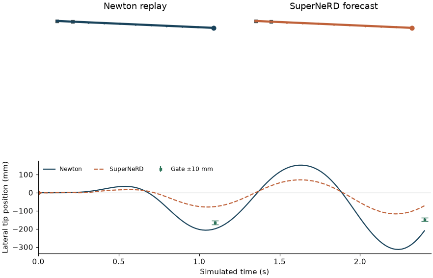
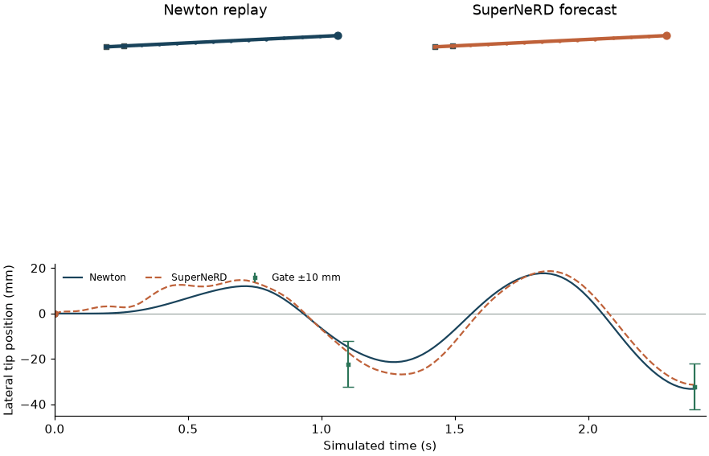

# Two lateral cable-tip gates

A root-clamped elastic rod receives two bounded, smooth transverse loads on its final segment. From its release state and two desired lateral tip coordinates, a planner chooses two pulse amplitudes. Newton advances the rod under the chosen command. The task passes if the tip's world-y position is within **10 mm at both 1.10 s and 2.40 s**. Each pulse amplitude is bounded to ±10 m/s², in addition to the prescribed nominal acceleration. The two-dimensional task measures control of a moving flexible tip in free space. Robot grasps, insertion, contacts and a physical board are separate tasks.

Eight held-out geometries (seeds 51240–51247) each supply four goals, one in each sign quadrant of pulse amplitude. Each goal comes from a continuous hidden command with magnitudes from 5 to 9 m/s². Only the two coordinates, initial state, material and geometry, and ordinary prescribed loading are supplied to the planner. The secret amplitudes are used to create the reachable targets and to check numerical sensitivity. Four goals from one cable share its geometry; the eight cables are the independent units.

## Results

The original SuperNeRD can steer the tip through both gates on **16 of 32** tasks, compared with 2 for the nominal loading alone. NeurALL has the lowest average miss among the learned models and the smallest native-shape error. Each model can produce a useful command despite differences in its overall shape forecast. The table uses the original 25 discrete commands and a full native-trajectory readout. Errors average the worse of each goal's two misses. [Primary results](results/summary.json)

| Planner | Both gates within 10 mm | Mean worst miss | Median decision | Decision + Newton execution |
|---|---:|---:|---:|---:|
| Nominal loading | 2/32 | 43.84 mm | <0.001 ms | 0.515 s |
| SuperNeRD original | 16/32 | 33.79 mm | 14.06 ms | 0.532 s |
| SuperNeRD mixed | 13/32 | 35.64 mm | 13.76 ms | 0.530 s |
| NeurALL GRU | 14/32 | 14.44 mm | 5.77 ms | 0.525 s |
| Newton, 25 commands | 20/32 | 9.95 mm | 13,008 ms | 13.524 s |

Direct Newton evaluates every discrete command exactly. Its 20/32 establishes the best achievable discrete-controller score for this action set. With continuous amplitudes, a three-probe Newton controller reaches **32/32** with 0.76 mm mean worst miss, 2.12 s planning and 2.83 s including execution. The original SuperNeRD interpolates its 25 predictions and reaches 16/32, with a 20.65 mm mean worst miss. Mixed SuperNeRD has 13/32. Correcting its predicted nominal path with one actual Newton rollout raises it to 20/32, at 0.72 s planning and 1.43 s with execution. NeurALL reaches 14/32 and has a 14.02 mm mean worst miss. [Continuous controller results](results/continuous-summary.json)

A two-probe controller uses zero additional load and a simultaneous +5 m/s² on both pulses. The later pulse begins after the first gate. Assuming that the earlier pulse has no effect left at the second gate gives **26/32** successes, 6.17 mm mean worst miss, and 2.105 s planning plus execution. Inferring this remaining effect from the mixed SuperNeRD's relative pulse responses also reaches 26/32, at 7.60 mm and 2.107 s. The experiment used the same held-out tasks after the three-probe result. [Matched two-probe controllers](results/two-probe.json)

**Exact task-specific acceleration.** For fixed initial state and geometry, SuperNeRD's stable modal recurrence is affine in the applied load. We compute the states at the two requested instants from the nominal waveform and the two pulse responses, then evaluate the trained nonlinear decoder there. NeurALL's optimized path runs the GRU sequence and decodes the two gates. All 32 discrete decisions matched the corresponding full-rollout path for each checkpoint. Maximum error in the two tip coordinates was 0.00024 mm. Values below are warmed one-core decision timings, including construction of 25 candidates and action selection, measured in a separate run. [Per-geometry timing and parity](results/fast-planning.json)

| Planner | Full trajectory | Two gates only | Ratio |
|---|---:|---:|---:|
| SuperNeRD original | 12.24 ms | 0.567 ms | 21.6× |
| SuperNeRD mixed | 12.40 ms | 0.569 ms | 21.8× |
| NeurALL GRU | 8.59 ms | 7.386 ms | 1.16× |

**Numerical sensitivity.** Doubling the Newton substeps and iteration budget moved the two-gate targets from the exact same witness action by 61.87 mm on average, using the worse of the two gate shifts. Zero of 32 witnesses still met the original 10 mm goal. Of the 32 chosen three-probe Newton commands, all met the corresponding regenerated refined target and none met the original fixed world coordinates in the refined solver. The reported stock success is specific to the stock teacher. [Witness and per-controller sensitivity](results/continuous-summary.json)

## Planners and timing

- Zero additional force is the default baseline.
- The original SuperNeRD shared cable/cloth checkpoint, the mixed continuation at fixed training seed 271, and the NeurALL 104,096-trajectory GRU all forecast native cable vertices on the same 25 commands. The two amplitudes take values −10, −5, 0, 5, 10 m/s². Each planner chooses the command minimizing the larger of its two predicted gate distances. The direct Newton controller scores the same 25 commands. This is a decision-quality test with identical candidate actions.
- The original benchmark's tolerance is 10 mm. Results also give 5 and 20 mm thresholds for visibility into sensitivity to that choice.
- A supplementary continuous-control test uses the same 25 rollouts to construct a piecewise-linear map from the amplitude square to the two gate positions. Each grid cell becomes two triangles. The planner inverts this map, choosing the lowest-amplitude solution at equal task error. Where the target lies outside the piecewise-linear image it chooses the closest point by Euclidean distance. All chosen continuous actions are simulated anew in Newton.
- Two additional continuous baselines use Newton during planning. One corrects SuperNeRD's predicted gate positions with one nominal Newton replay. The other estimates an affine gate-response map from three Newton replays (zero, +5 for pulse one, +5 for pulse two) and uses bounded least squares. All three replay costs are charged to the latter planner. The continuous experiments are follow-ups on the same 32 goals after observing first-half grid results.
- All wall clocks use single-core CPU workers on an Intel Core Ultra 9 285K. Across geometries, multiple workers run in parallel. Learned models batch the 25 candidates, use PyTorch FP32 inference and generate the complete native shape sequence. Newton serially evaluates them using one warmed VBD scene per geometry and fresh solver and state buffers per candidate. Its native exporter also reads segment orientations and velocities. This comparison measures these implementations; optimized multiworld Newton kernels and GPU scaling were outside this experiment.
- Every goal is charged for scoring a **new** bank. We measure one bank per geometry and reuse its measured cost across the four targets, with a separate target decision cost. Learned bank latency is the median of five measured timings after warm-up. Model loading, offline generation of targets and one-time scene creation are excluded. Separate totals include executing each chosen action once in Newton. Reuse of an already-scored bank across subsequent goals would allow all planners to answer those subsequent queries more quickly.
- The stock teacher has four VBD substeps and eight iterations per 20 ms interval. The refined teacher uses eight substeps and sixteen iterations, keeping forces and timestamps fixed. All controller choices are replayed with both. A change of teacher can move the target generated by the same command. The continuous audit reports both the original world coordinates and a target regenerated on the refined teacher using its original hidden witness.

The animation shows geometry 51240 and target zero, chosen by index. It plots the selected mixed SuperNeRD action, the predicted native shape and the actual Newton replay. This is a wireframe rendering of simulation data. Green bars mark the permissible world-y interval at the two gate times.

The second animation is the first passing mixed SuperNeRD case among the target-zero runs, geometry 51243. Newton missed the centers by 7.45 mm and 1.04 mm. The first animation misses by 34.12 mm and 62.12 mm.

## Reproduce

Use the pinned Newton, Warp, NumPy, SciPy and PyTorch environment of the main report. From the SuperNeRD repository root, run:

~~~sh
export OMP_NUM_THREADS=1 OPENBLAS_NUM_THREADS=1 MKL_NUM_THREADS=1
export PYTHONPATH="$PWD/deformables"
python tasks/cable/cable_gates.py --parent deformables/weights/modal-paired.pt --mixed deformables/gradients/results/retention/mixed-271.pt --neurall tasks/cable/neurall-v7-cable.pt --output replay/cable --workers 4
python tasks/cable/export_bank.py --results replay/cable --output replay/cable/candidate-bank.json --workers 4
python tasks/cable/continuous.py --parent deformables/weights/modal-paired.pt --mixed deformables/gradients/results/retention/mixed-271.pt --neurall tasks/cable/neurall-v7-cable.pt --output replay/cable --workers 4
python tasks/cable/fast_planner.py --parent deformables/weights/modal-paired.pt --mixed deformables/gradients/results/retention/mixed-271.pt --neurall tasks/cable/neurall-v7-cable.pt --results replay/cable --output replay/cable/fast-planning.json
python tasks/cable/two_probe.py --mixed deformables/gradients/results/retention/mixed-271.pt --results replay/cable --output replay/cable/two-probe.json --workers 4
python tasks/cable/render_gates.py --example replay/cable/example-51240.npz --output replay/cable/gates.gif
~~~

The [offline reference bank](results/candidate-bank.json) maps each geometry seed to its 25 commands in m/s² and their two Newton gate coordinates in meters. Candidate indices are zero-based and use the same lexicographic order for every geometry. Held-out models should output their choices using only the goals, initial state, geometry and prescribed loading. The evaluator indices then select the corresponding reference outcomes.

Use a new output directory for a new timing run; per-object receipts allow an interrupted experiment to resume. The released inference bundle is the **project's own NeurALL GRU**, trained on Newton-generated trajectories. It contains only the GRU and readout weights, cable shape basis, static normalization, length-projection flag and the upstream checkpoint digest. Its source is the v7 training checkpoint selected at step 624,000. The full archived checkpoint SHA-256 is 84c23339f7ec1aea651eb8ba1a0b274965246c0c5bb94955983e17e187c18d0b. The portable adapter matched the archived NeurALL packed CPU implementation to 0.00052 mm maximum absolute coordinate difference on all 25 candidate rollouts for the first case. [NeurALL scale study](https://maxkra15.github.io/neurall/#elastic-shared-load-scale-v7) · [Adapter verification](neural-parity.json).

The optional parity script uses the earlier NeurALL training checkout and original GRU checkpoint. Set PYTHONPATH to include both the earlier Newton repository root and this repository's deformables directory, then run parity_check.py with the original and portable checkpoints. Neither an internal cable model nor an external third-party model was used.
