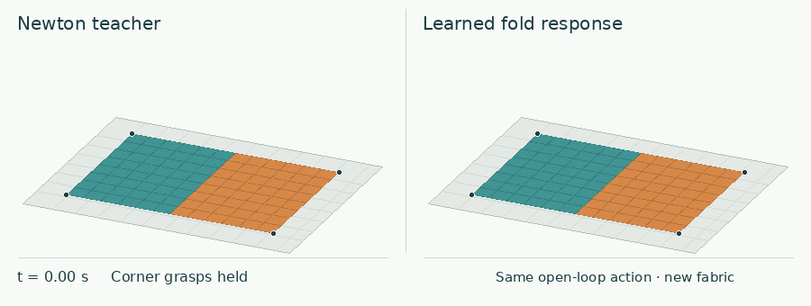

# Tabletop cloth folding with a learned trajectory model

Move the two far corners of a flat cloth over the opposite side, release all four corners, and leave a settled overlapping fold. A learned model ranks 12 open-loop grasp programs on a new fabric and target. A hybrid planner replays the three best-ranked programs in Newton before choosing a command. Each success below was measured in Newton after release.

| Planner on the 16 confirmation tasks | Newton candidates evaluated to plan | Successful folds | Mean full-mesh error to target, % of cloth length |
|---|---:|---:|---:|
| Leave it flat | 0 | 0 | 32.81 |
| Geometric two-corner fold | 0 | 8 | 3.79 |
| Learned ranking only | 0 | 9 | 2.80 |
| Geometric program + two seeded alternatives checked in Newton | 3 | 11 | 2.69 |
| Top three learned programs checked in Newton | 3 | **14** | **2.03** |
| Score all 12 programs in Newton | 12 | 15 | 2.00 |

On one warmed CPU core, the four-task counterbalanced timing averaged 15.625 s to evaluate all 12 candidates with Newton, 3.996 s for model ranking plus three independent Newton replays (3.91× faster), and 1.736 ms for model-only ranking. All methods include command application, complete shape rollout, scoring and selection. Timings exclude offline training, evaluation of the selected action during benchmark scoring, rendering and saving files. Training-set acquisition and fitting are measured separately. The earlier two-case timing coincided with other captures and is retained in [the first timing receipt](two-case-timing.json).

These are 16 distinct cloth geometries and material configurations, with one target fold each. The coarse ranking objective favors shape, low height and aligned corners. The binary pass additionally checks residual speed and three separate geometric thresholds. In the confirmation bank the learned shortlist contained a passing candidate on 15/16 tasks, the equal-budget geometric shortlist on 11/16 and the full bank on 16/16. Those coverage numbers count available choices. The table reports what the fixed planner actually selected.

For inputs outside the checkpoint’s observed fabric and command ranges, an optional planner checks all candidates in Newton. It completed 14/16 original confirmation folds using 66 native episodes. [Training-range check, invocation and reproduction](GUARDED-PLANNER.md)

## Task and teacher

Newton VBD advances a 12×8-cell triangulated patch (117 vertices) on a frictional horizontal support. Cloth self-contact, vertex–face and edge–edge contact handling are enabled. Each fabric varies in length (0.45–0.61 m), width (0.29–0.40 m), membrane and bend stiffness, and particle mass through areal density. Two ideal kinematic grasps carry the right edge’s corners along a smooth arc; two opposite corners hold their original positions. At 1.06 s all four corners become dynamic. Newton then simulates the remaining 0.54 s, for a total of 1.6 s and 80 output steps at 50 Hz. Each output step has three simulation substeps and six solver iterations per substep. The table is represented by an infinite horizontal plane. Explicit grasp acquisition, gripper slip and misses are outside this benchmark.

The target folds the cloth about a prescribed transverse crease. Reflecting the original vertex positions about this crease specifies the desired overlapping layers. Success requires native-vertex RMS position error ≤5% of cloth length, both grasp corners within 10%, 95th-percentile height ≤35 mm, and mean terminal speed ≤50 mm/s. The shape measurement averages the last six frame positions before comparing to the target. The ranker uses the normalized mean shape distance, excess height and excess corner distance. These criteria were fixed before the corresponding evaluation. [Initial protocol](protocol.json) · [Confirmation design](protocol-confirmation.txt) · [All candidate scores](all-candidates.json).

## Model and scope

The folding expert is a differentiable radial basis function network with an affine trend. Its eight features describe the initial fabric and the grasp program’s landing fraction, lift amplitude and release height. Ridge fitting learns native XYZ trajectories at 21 time knots. Linear temporal interpolation produces 81 frames including release. Inputs select the entire open-loop grasp program before motion begins. The model has one fixed topology and grasp schedule; arbitrary mid-rollout actions and state restarts require another design. The earlier shared cable/cloth modal checkpoint accepts applied accelerations on clamped contact-free objects and cannot directly express this tabletop action. The folding expert has separate weights and does not demonstrate checkpoint merging. The readout is differentiable in the command and fabric inputs; the planners measured here use candidate evaluation. [Model checkpoint](fold-response.npz) · [Autodiff check](differentiability.json).

Training used 192 random fabric/program pairs and eight no-movement examples. Capture took 32.59 s on ten local CPU workers. The median single-thread fit across three runs took 0.237 s including compressed data reads and checkpoint writes. The initial 16 held tasks led to 7/16 learned, 6/16 geometric and 13/16 all-candidate Newton successes. The model's predicted pass/fail disagreed with Newton on 10/16 initial tasks. The three-shot hybrid was developed after that evaluation. Its separate confirmation set uses seeds 50300–50315. There was no checkpoint change between the two sets. [Initial results](results.json) · [Confirmation](confirmation.json) · [Planner timings](timings.json).

## Physical checks

On the confirmation bank, 11/16 model-only selected predicted endpoint meshes had strict intersections between nonadjacent edges and faces. Every selected Newton replay in the confirmation table ended with zero such crossings. All hybrid-selected executions had the sampled upper material above the lower layer wherever their projected footprints overlapped. The terminal geometric test excludes exact coplanar/edge boundary coincidences and does not certify collision-free motion at every substep. The initial-bank model-selected *Newton* trajectories reached a worst transient vertex depth of 0.96 mm below the support plane and a worst edge-length ratio of 1.24. The model's trajectories can contain larger artifacts. A low average vertex error alone cannot certify contact plausibility.

We repeated the first four initially held, model-selected commands at six substeps and twelve solver iterations. Two of their four binary outcomes changed. Native endpoint disagreement against the base setting ranged from 0.9 to 23.0 mm. Doubling both spatial resolution and the substep/iteration settings yielded 1.0–13.1 mm disagreement at corresponding native vertices and four passes. Timing and success claims apply to the specified discretization. [Refinement audit](teacher-refinement.json).

## Reproduce

Use the pinned SuperNeRD environment with Newton revision 0ced8f8420d4ee1eab9ecfaee59e1354ef670348, Warp 1.19.0.dev20261020 and the NumPy, PyTorch and Pillow packages. Run the following from this directory in the environment. The capture scripts regenerate every trajectory and the score reports. Candidate scoring requires no network access or private assets.

~~~sh
export OPENBLAS_NUM_THREADS=1 OMP_NUM_THREADS=1
python experiment.py train --output train --workers 10
python experiment.py test --output test --workers 8
python learn.py --root .
python experiment.py confirm --output confirm --workers 8
python hybrid.py evaluate --root .
python candidate_audit.py --root .
python hybrid.py timing --root .
python validation.py
python render.py
~~~

For the supplied animation, the first confirmation fabric is shown on both sides with the command selected by the hybrid. Left is Newton, right is the surrogate prediction for that same command. The rendering uses recorded native vertex positions, depth-tested faces, and material-space colors distinguishing the initially near and far halves. [Underlying motion](hybrid-example.npz).
